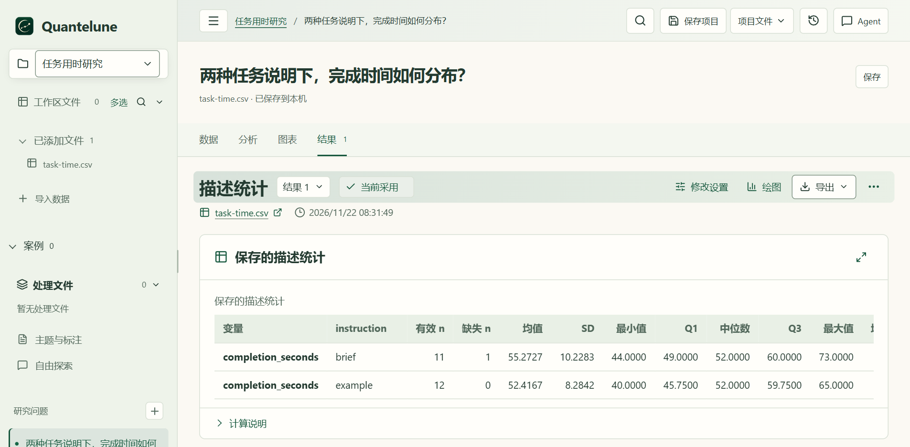
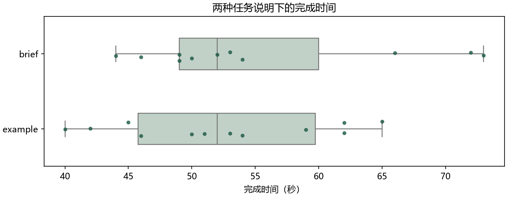
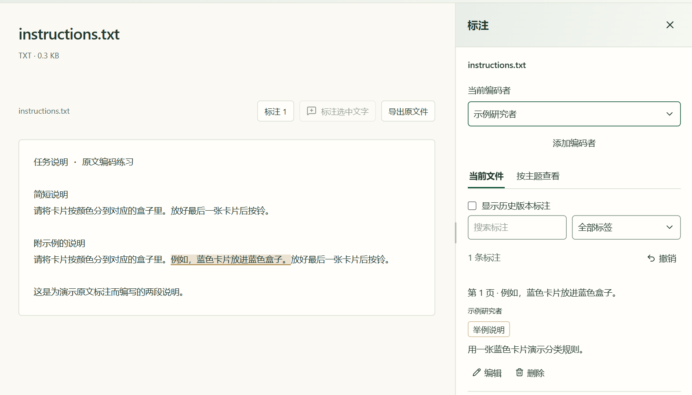

<picture>
  <source media="(max-width: 600px)" srcset="docs/images/quantelune-cover-compact.png">
  
</picture>

**Quantelune** 是一款 Windows 研究软件，可以在同一个本地项目里阅读原文、回听录音、标注片段，也可以用表格做统计、机器学习和绘图。研究问题把使用的数据版本、图表和结果放在一起，方便你日后重新打开，查清一份结果来自哪里。

**当前公开版本为 2.0.18 源码。** 可以在 Windows 上启动本地预览。独立安装包尚未公开发布。

[运行源码预览](docs/getting-started.md)　·　[跟做统计示例](#用一张表完成第一次分析)　·　[跟做原文标注](#给一段原文标注主题)

## 工作区里的一项研究

下面是 Quantelune 用公开示例算出的结果。左侧可以切换原文件和研究问题，中间同一个问题下有「数据」「分析」「图表」「结果」四个入口。结果表上方的 `task-time.csv` 可以点回分析实际使用的数据。

[](docs/images/research-results.png)

你可以先看一份原始材料，再决定怎样组织研究。临时比较几份材料时，直接多选即可。需要持续跟踪一个人、一次会话或一组材料时，再保存为具名案例。调整分析设置或图形样式后，可以回看旧版，与新的结果比较。

## 用一张表完成第一次分析

**带示例的说明和简短说明，两组的任务用时有什么不同？** 仓库提供了 24 条模拟任务记录，每行是一次任务，时长单位是秒。这个例子从一个很容易忽略的地方开始：两组各有 12 行，但其中一组只有 11 个有效时长。

1. **看原表。** 打开示例文件夹，点 `task-time.csv`。找到会话 `S07`，它的 `completion_seconds` 留空，说明类型 `instruction` 是 `brief`。
2. **按组统计。** 在研究问题的「分析」里添加「描述统计」，数值选 `completion_seconds`，分组选 `instruction`。运行后查看本次结果，核对有效数与缺失数。
3. **看分布。** 在「图表」中选择「箱线与原始观测」，使用相同的数值和分组。下图由 Quantelune 绘图服务用这份表导出，每个点对应一次有时长记录的任务。

| 说明类型 | 有效记录 | 缺失 | 均值（秒） | 中位数（秒） | 最小至最大（秒） |
| --- | ---: | ---: | ---: | ---: | ---: |
| 简短说明 `brief` | 11 | 1 | 55.27 | 52 | 44–73 |
| 附示例 `example` | 12 | 0 | 52.42 | 52 | 40–65 |

[](docs/images/task-time-boxplot.png)

两组的中位数都是 **52 秒**。若只看均值，会错过这个共同点。可以从「结果 → 导出」带走统计表 CSV，让合作者用同一张原表核对。[示例 CSV](examples/task-time/task-time.csv) · [数据生成脚本](examples/make_demo.py)

## 给一段原文标注主题

原文标注可以从一个 TXT 开始。打开随仓库提供的练习文稿，选中「例如，蓝色卡片放进蓝色盒子。」，点击「标注选中文字」，赋予主题「举例说明」。下图是保存后的材料页，原句在正文中高亮，右侧保留了主题、备注和定位入口。

[](docs/images/annotated-text.png)

在右侧点击这条标注，可以回到原句。材料多起来后，从左侧「主题与标注」按主题回看，还可以导出标注。练习文稿为演示所写，可以直接下载并试用。[原文编码练习 TXT](examples/instructions/instructions.txt)

## 按材料选择工具

| 手头的材料 | 可以做的研究工作 |
| --- | --- |
| **表格、问卷和记录型 JSON** | 查看 CSV、XLSX、Parquet 或 JSON 中的字段与缺失情况，准备分析表，做描述统计、组间比较、回归，或建立分类与回归模型。 |
| **文字与带文字层的 PDF** | 选取原句、添加主题与备注，按主题汇总，再回到相应段落或页码。 |
| **录音、视频与对应文本** | 播放和回听选段，创建时间标注，转录并校对。按需计算音高、强度、MFCC 或 RMS，分别保留曲线和统计摘要。 |
| **图片与视频帧** | 对图片区域编码，从视频提取帧图，回看原画面。安装相应模型后，可进一步提取视觉特征并比较图片。 |
| **多路时间信号** | 对已适配的 BIDMC 会话，共用时间轴查看不同通道，选择范围、切窗并打包完整序列，再用窗口摘要做分析。 |

### 什么时候使用 Agent

材料查看、人工编码、统计和手动绘图都可以独立完成。配置模型后，可以在当前研究问题旁请求「按说明类型汇总完成时间」，或在图旁要求「把标题改为两组任务的完成时间」。真正运行的工具会把结果保存到项目中，便于打开统计表或图形复核。使用外部模型时，发送的内容取决于项目设置及当次授权。

## 运行与开发

在装好 Git、Node.js 22、pnpm 11.15.1、uv 和 Python 3.12 的 Windows x64 电脑上，可以从 PowerShell 运行：

```powershell
git clone https://github.com/CurlyAhao/Quantelune.git
cd Quantelune
pnpm install --frozen-lockfile
uv sync --directory apps/api --frozen --python 3.12
.\Start-Web-Preview.cmd
```

启动后，在浏览器打开 `http://127.0.0.1:3146`。表格示例使用本地 SQLite。转录、媒体特征和桌面安装构建需要额外的本地组件，具体输入见[Windows 运行与打包指南](docs/getting-started.md)。

| 源码入口 | 负责什么 |
| --- | --- |
| [工作区界面](apps/web) | 材料阅读、研究问题、结果、图表、标注和 Agent 侧栏 |
| [本地分析服务](apps/api) | 文件导入、数据库、统计计算、媒体处理和模型工具调用 |
| [Windows 桌面壳](apps/desktop) · [打包脚本](scripts/packaging) | Tauri 桌面入口、文件对话框和 NSIS 安装流程 |

项目源码采用 [MIT 许可证](LICENSE)。可选媒体工具、字体和模型分别遵循其发行方的许可。
